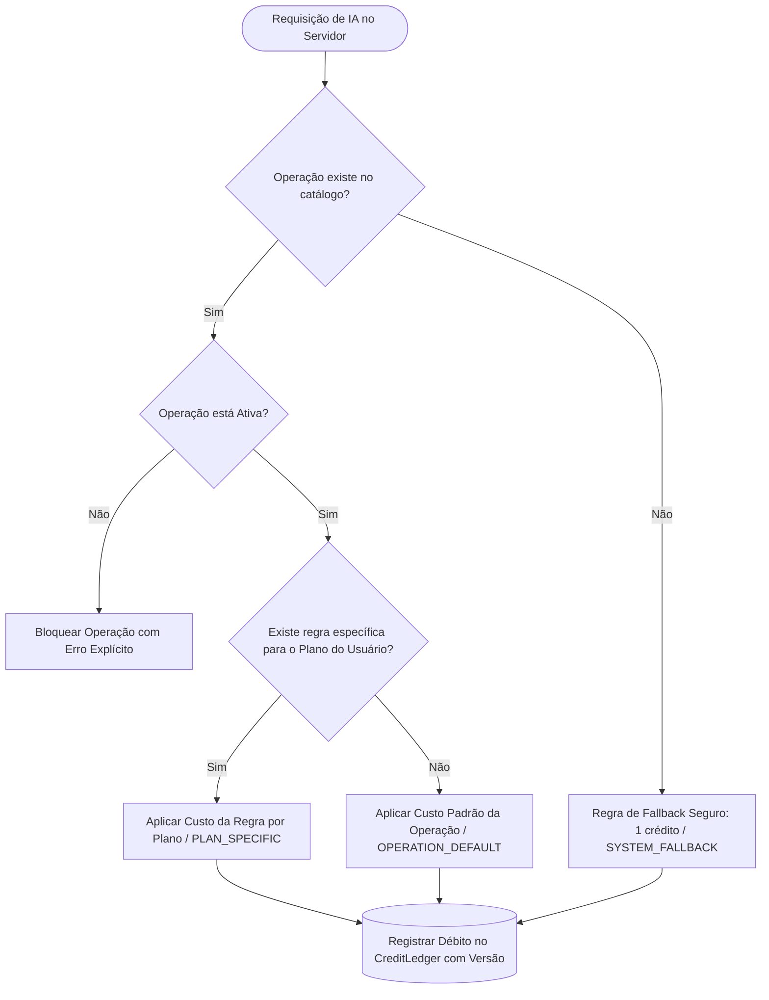

# 14 — Central de Custos em Créditos e Políticas de Renovação

Este documento estabelece as especificações arquiteturais, os modelos de dados, o fluxo de cobrança de IA e o manual de operação para a **Central de Limites, Recursos, Custos e Renovação de Créditos** (`/admin/billing` — Aba *4. Limites, Recursos & Custos*) do CinePrompt Studio AI (Tomadix).

Nenhum valor comercial ou custo de operação fica disperso em constantes estáticas ou arquivos de configuração que exijam novos deploys de código. Todas as regras são gerenciadas dinamicamente via banco de dados e aplicadas estritamente no servidor.

---

## 1. Catálogo Dinâmico de Operações Cobradas (`CreditOperation`)

Cada operação de inteligência artificial ou geração cinematográfica possui um código único, estável e auditado:

```prisma
model CreditOperation {
  id                String              @id @default(cuid())
  code              String              @unique
  name              String
  description       String?
  category          String
  defaultCreditCost Int
  isFree            Boolean             @default(false)
  isActive          Boolean             @default(true)
  version           Int                 @default(1)
  pricingRules      CreditPricingRule[]
  createdAt         DateTime            @default(now())
  updatedAt         DateTime            @updatedAt
}
```

### Operações Pré-Carregadas e Localização na Interface do Estúdio

Todas as operações configuráveis na tabela de créditos estão ativas e implementadas ponta a ponta na plataforma:

| Código da Operação | Nome de Apresentação | Custo Padrão | Localização na Interface do Estúdio | Endpoint de API |
| :--- | :--- | :---: | :--- | :--- |
| `EXPAND_SCENE` | Expansão de Cena | 4 cr | Card individual da cena em **Cenas** (`ScenesTab` - Ícone de expansão) | `POST /api/projects/[id]/scenes/[sceneId]/expand` |
| `GEN_SCENE_SEQUENCE` | Geração de Sequência de Cenas | 12 cr | Botão **"✨ Sequência com IA"** no topo da aba de **Cenas** | `POST /api/projects/[id]/scenes/generate-sequence` |
| `GEN_SCRIPT` | Geração de Roteiro Completo | 15 cr | Botão **"🎬 Roteiro com IA"** no topo da aba de **Cenas** | `POST /api/projects/[id]/script/generate` |
| `GEN_CHARACTER` | Geração de Personagem com IA | 5 cr | Botão **"✨ Gerar com IA"** na aba de **Personagens** (`CharactersTab`) | `POST /api/projects/[id]/characters/generate` |
| `GEN_ENVIRONMENT` | Geração de Ambiente com IA | 3 cr | Botão **"✨ Gerar com IA"** na aba de **Ambientes** (`EnvironmentsTab`) | `POST /api/projects/[id]/environments/generate` |
| `GEN_VISUAL_BIBLE` | Geração de Bíblia Visual | 10 cr | Card **"Bíblia Visual"** na aba **Visão Geral** do projeto | `POST /api/projects/[id]/visual-bible/generate` |
| `GEN_IMAGE_PROMPT` | Geração de Prompt de Imagem | 2 cr | Botão **"Gerar Prompt"** no Motor de Prompts | `POST /api/projects/[id]/prompts/generate` |
| `GEN_VIDEO_PROMPT` | Geração de Prompt de Vídeo | 8 cr | Botão **"Gerar Prompt"** no Motor de Prompts | `POST /api/projects/[id]/prompts/generate` |
| `REWRITE_ENHANCE` | Aprimoramento de Prompt | 2 cr | Botão **"✨ Aprimorar com IA"** nas diretrizes do Motor de Prompts | `POST /api/projects/[id]/prompts/enhance` |
| `BATCH_GENERATION` | Geração em Lote | 20 cr | API de processamento paralelo em lote de prompts de cenas | `POST /api/projects/[id]/prompts/batch` |
| `CINEMATIC_ANALYSIS`| Análise Cinematográfica Multimodal | 2 cr | Módulo de **Análise Cinematográfica** (`/analysis`) | `POST /api/cinematic-analysis` |
| `QUICK_CREATION` | Criação Rápida no Estúdio | 1 cr | Barra inferior de **Criação Rápida** com menções (`@`, `#`, `$`) | `POST /api/studio/quick-create` |

Novas operações podem ser cadastradas a qualquer momento diretamente pelo painel administrativo.

---

## 2. Serviço Centralizado de Execução com Créditos (`CreditExecutionService`)

Para garantir que nenhuma rota da aplicação consuma recursos sem a devida cobrança atômica e proteção contra falhas, foi introduzido o `CreditExecutionService.executeWithCredits`:

1. **Validação e Preço Pré-Execução**:
   - Resolve dinamicamente o custo da operação com base no plano atual do workspace (`CreditPricingService.resolveCost`).
   - Verifica se o estúdio possui saldo disponível suficiente (`EntitlementService.assertCanConsumeCredits`).
2. **Dedução Atômica em Transação de Banco**:
   - Executa `workspace.update` com decremento de créditos e registra entrada detalhada no `CreditLedger`.
3. **Execução Segura da Tarefa de IA**:
   - Executa a função de trabalho (geração de prompt, chamada à Gemini API, decupagem ou análise de imagem).
4. **Estorno Automático em Falhas (`CREDIT_REFUND_ON_FAILURE`)**:
   - Caso a chamada externa à IA falhe (timeout, erro de API, bloqueio de segurança), o valor integral dos créditos deduzidos é estornado automaticamente para o workspace (`workspace.update` incrementando saldo) e registrado no `CreditLedger` com justificativa do erro.
5. **Sincronização em Tempo Real na Interface**:
   - Dispara evento `tomadix:credits-updated` com o novo saldo retornado pela transação, garantindo que o componente `CreditBadge` no cabeçalho exiba o valor atualizado imediatamente sem recarregar a página (F5).

---

## 3. Tela Dedicada de Configuração de Custos por Tipo de Criação (`/admin/credits`)

Para que a administração da plataforma possa redefinir os custos de execução de cada tipo de criação sem alterar código, foi disponibilizada a página dedicada **"Custos de Execução em Créditos por Tipo de Criação"** (`/admin/credits`), acessível diretamente no menu lateral sob a seção **Gestão**:

- **Filtros por Tipo de Criação**:
  - `Prompts de IA`: Prompts de imagem, vídeo, bíblia visual e aprimoramento.
  - `Cenas & Roteiro`: Sequências, roteiro completo e expansão de cenas.
  - `Personagens & Ambientes`: Criação de personas e cenários cênicos.
  - `Multimodal & Estúdio`: Análise cinematográfica computacional e barra de criação rápida.
  - `Processamento & Lote`: Execuções em lote e renderizações paralelas.
- **Edição Direta de Valores**:
  - Campo numérico para ajustar o custo em créditos com salvamento imediato no banco de dados.
  - Toggle para isenção total (`isFree`).
  - Toggle para suspensão/ativação da operação (`isActive`).
- **Regras Customizadas por Plano**:
  - Permite conceder gratuidade ou valores reduzidos para planos específicos (`FREE`, `PRO`, `TEAM`, `ENTERPRISE`).
- **Simulador Interativo de Cobrança ao Vivo**:
  - Testa na hora o cálculo exato resolvido pelo motor para qualquer combinação de operação e plano contratado.

---

## 2. Regras Específicas por Plano (`CreditPricingRule`)

O administrador pode definir descontos ou gratuidades condicionadas ao plano do assinante:

```prisma
model CreditPricingRule {
  id             String          @id @default(cuid())
  operationId    String
  operation      CreditOperation @relation(fields: [operationId], references: [id], onDelete: Cascade)
  planTier       PlanTier?       // FREE, PRO, TEAM, ENTERPRISE
  creditCost     Int
  isFree         Boolean         @default(false)
  effectiveFrom  DateTime        @default(now())
  effectiveUntil DateTime?
  priority       Int             @default(1)
  isActive       Boolean         @default(true)
  version        Int             @default(1)
  createdAt      DateTime        @default(now())
}
```

*Exemplo:* A operação `GEN_CHARACTER` custa 5 créditos no plano `FREE`, mas pode ser configurada para custar 2 créditos no plano `PRO` e ser gratuita (`isFree: true`, 0 créditos) no plano `ENTERPRISE`.

---

## 3. Resolução Hierárquica Determinística de Custo (`resolveCost`)

O serviço `CreditPricingService.resolveCost(operationCode, planTier)` resolve o valor cobrado com base na seguinte precedência rigorosa:



**Garantias de Segurança:**
1. **Sem Gratuidade Silenciosa**: Se uma operação não estiver cadastrada ou uma regra falhar, ela nunca é tratada como gratuita por engano.
2. **Imutabilidade Histórica**: Alterações de preço futuras não alteram o histórico de débitos passados no ledger.
3. **Validação Server-Side**: O custo é sempre recalculado no servidor; valores enviados pelo frontend são completamente ignorados.

---

## 4. Simulador de Custos em Tempo Real

Disponível no painel administrativo (`CreditPricingTab`), o simulador permite que o operador selecione qualquer combinação de Operação e Plano de Assinatura para visualizar:
- Custo efetivo resolvido em créditos.
- Regra aplicada (`PLAN_SPECIFIC`, `OPERATION_DEFAULT`, `SYSTEM_FALLBACK`).
- Versão ativa da regra.
- Indicação visual se a operação é tarifada ou gratuita.

---

## 5. Sistema Configurável de Renovação de Créditos (`CreditRenewalPolicy`)

O sistema permite configurar concessões periódicas automatizadas e idempotentes de créditos:

```prisma
model CreditRenewalPolicy {
  id             String    @id @default(cuid())
  name           String
  description    String?
  planTier       PlanTier? // FREE, PRO, TEAM, ENTERPRISE
  creditsAmount  Int
  frequency      String    // DAILY, WEEKLY, MONTHLY, YEARLY, ONCE
  moment         String    @default("CYCLE_RENEWAL")
  accumulate     Boolean   @default(false)
  maxAccumulated Int?
  expirationDays Int?
  priority       Int       @default(1)
  isActive       Boolean   @default(true)
  startsAt       DateTime  @default(now())
  endsAt         DateTime?
  createdAt      DateTime  @default(now())
}
```

### 5.1. Periodicidades Suportadas
- **`DAILY`**: Concessão diária (ex: 5 créditos/dia para o plano `FREE`).
- **`WEEKLY`**: Concessão semanal.
- **`MONTHLY`**: Recarga mensal (ex: 100 créditos/mês para o plano `PRO`).
- **`YEARLY`**: Cota anual de créditos.
- **`ONCE`**: Concessão única promocional ou de onboarding.

### 5.2. Chave de Idempotência e Concorrência Segura
O método `CreditRenewalService.executeRenewalJob()` cria uma chave de idempotência exclusiva para cada workspace e ciclo temporal:

$$\text{idempotencyKey} = \text{"renewal\_"} + \text{policyId} + \text{"\_"} + \text{workspaceId} + \text{"\_"} + \text{cycleMarker}$$

* Se o job for executado repetidas vezes no mesmo dia ou mês, o sistema identifica a concessão já registrada no `CreditLedger` e ignora o workspace (`skippedCount++`), **impedindo duplicidade de créditos**.
* Se a assinatura estiver com status `PAST_DUE`, `UNPAID` ou `CANCELED`, o estúdio é ignorado até que a regularização financeira seja confirmada pelo gateway de pagamento.

### 5.3. Política de Acúmulo de Saldo (`accumulate`)
- **`accumulate: true`**: Os novos créditos são somados ao saldo remanescente. Opcionalmente, pode ser definido um teto máximo (`maxAccumulated`).
- **`accumulate: false`**: O saldo anterior é substituído pela nova cota caso o saldo atual seja inferior à cota da política.

---

## 6. Endpoints da API (`/api/admin/billing`)

| Método | Rota | Descrição | Permissão |
| :--- | :--- | :--- | :--- |
| `GET` | `/api/admin/billing/credit-operations` | Lista catálogo de operações cobradas | `plans:manage` |
| `POST` | `/api/admin/billing/credit-operations` | Cadastra nova operação no catálogo | `plans:manage` |
| `POST` | `/api/admin/billing/credit-operations/[id]/rules` | Cria regra de preço para plano específico | `plans:manage` |
| `DELETE`| `/api/admin/billing/credit-operations/[id]/rules` | Remove regra de preço específica | `plans:manage` |
| `POST` | `/api/admin/billing/credit-operations/simulate` | Simula a resolução de custo em tempo real | `plans:manage` |
| `GET` | `/api/admin/billing/credit-renewal` | Lista políticas de renovação de créditos | `plans:manage` |
| `POST` | `/api/admin/billing/credit-renewal` | Cria nova política de renovação de créditos | `plans:manage` |
| `PATCH` | `/api/admin/billing/credit-renewal/[id]` | Atualiza política de renovação existente | `plans:manage` |
| `DELETE`| `/api/admin/billing/credit-renewal/[id]` | Remove política de renovação | `plans:manage` |
| `POST` | `/api/admin/billing/credit-renewal/run-job` | Dispara o job de renovação em lote | `plans:manage` |

---

## 7. Manual Prático de Operação para Administradores

### Como Definir que uma Operação seja Gratuita para o Plano PRO
1. Acesse `/admin/billing` e clique na aba **"4. Limites, Recursos & Custos"**.
2. Na tabela *Catálogo de Custos em Créditos por Operação*, localize a operação desejada (ex: `Geração de Prompt de Imagem`).
3. Clique no botão **"+ Regra por Plano"**.
4. No modal:
   - Selecione o plano: `PRO`.
   - Marque a caixa de seleção: **"Operação gratuita neste plano"**.
5. Clique em **"Salvar Regra"**.
6. No *Simulador de Custo*, selecione a operação e o plano `PRO` para confirmar que o custo efetivo passou a ser `0 Créditos (Gratuito)`.

### Como Disparar o Ciclo de Renovação Manualmente
1. Na mesma aba, role até a seção *Sistema Configurável de Renovação de Créditos*.
2. Clique no botão **"⚡ Executar Ciclo de Renovação"**.
3. Confirme a execução no diálogo de confirmação.
4. O sistema exibirá o resumo instantâneo: total de estúdios analisados, total renovado com sucesso e total ignorado por já ter sido renovado no período.
