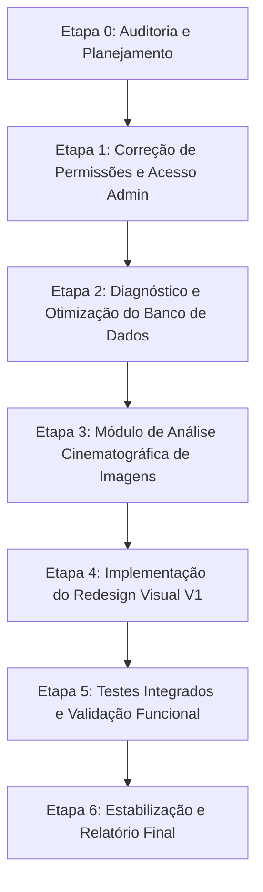

# TOMADIX — ETAPA 0: RELATÓRIO DE AUDITORIA TÉCNICA E PLANO DE EXECUÇÃO

**Projeto:** Tomadix  
**Data:** 27 de Outubro de 2026  
**Ambiente:** Windows (PowerShell), Next.js 15, TypeScript 5.7, Tailwind CSS v4, Prisma 6, Supabase PostgreSQL, Gemini API (`@google/genai`).

---

## 1. INTRODUÇÃO E ESCOPO DA AUDITORIA

Esta auditoria técnica avalia o estado atual da plataforma Tomadix V1 com o objetivo de fundamentar as correções de autorização, diagnóstico e eliminação de gargalos no banco de dados, implementação do motor multimodal de análise cinematográfica de imagens e aplicação do novo design system fornecido na pasta `stitch_tomadix_modern_nextjs_redesign`.

---

## 2. INSPEÇÃO TÉCNICA DO REPOSITÓRIO

### 2.1. Frameworks, Bibliotecas e Runtime
- **Frontend / Fullstack:** Next.js 15.0.0 (App Router), React 19.0.0, TypeScript 5.7.0.
- **Estilização:** Tailwind CSS v4.3.3 (`@tailwindcss/postcss`, `postcss.config.mjs`).
- **Banco de Dados & ORM:** PostgreSQL hospedado no Supabase via Prisma ORM 6.0.0.
- **Inteligência Artificial:** Google Gen AI SDK oficial (`@google/genai` v1.0.0), modelo padrão `gemini-3.5-flash`.
- **Validação de Schemas:** Zod v3.24.0.
- **Criptografia & Autenticação:** `bcryptjs` v3.0.3, tokens criptográficos SHA-256 com cookies `HttpOnly` (`cineprompt_session`).
- **Testes Automatizados:** Vitest v5.0.5 com 23 arquivos de teste cobrindo governança, segurança multitenant, regras de negócios e prompt engine.

### 2.2. Rotas, Páginas e Estrutura da Aplicação
- **Rotas Públicas:** `/`, `/login`, `/register`, `/pricing`, `/terms`, `/privacy`, `/confirm-email`, `/forgot-password`, `/reset-password`.
- **Estúdio & Projetos:**
  - `/studio`: Hub visual e galeria cinematográfica com criação rápida de projetos, personagens, ambientes e cenas.
  - `/projects`: Listagem paginada de projetos com filtros, ordenação e status de arquivo.
  - `/projects/[id]`: Visão geral do projeto, bíblia visual e atalhos de pré-produção.
  - `/projects/[id]/parameters`: Configuração personalizada de parâmetros habilitados para o projeto (9 categorias cinematográficas).
  - `/projects/[id]/scenes`: Gestão de cenas e geração contextual de prompts.
- **Parâmetros Dinâmicos:**
  - `/parameters`: Catálogo geral de parâmetros cinematográficos. *(Identificado ponto de vulnerabilidade visual/permissão)*.
- **Administração da Plataforma:**
  - `/admin`: Visão geral administrativa.
  - `/admin/parameters`: Console de governança global dos parâmetros cinematográficos (9 categorias, regras de snapshot e herança).
  - `/admin/billing`, `/admin/users`, `/admin/projects`, `/admin/usage`: Painéis de gestão administrativa.

### 2.3. Mecanismo de Autenticação e Autorização (RBAC)
- **Modelagem de Usuários e Papéis:**
  - `User.platformRole`: Enum `PlatformRole` (`USER`, `ADMIN`, `SUPER_ADMIN`).
  - `Workspace.memberships`: Enum `WorkspaceRole` (`OWNER`, `ADMIN`, `MEMBER`, `VIEWER`).
- **Vulnerabilidades Identificadas:**
  1. **Falha de Escopo em `parameters:manage`:** Em `src/lib/permissions.ts`, a permissão `"parameters:manage"` estava concedida aos papéis `OWNER` e `ADMIN` de workspace. Como todo usuário cadastrado é `OWNER` de seu workspace pessoal, a API `/api/parameters` (método `POST`, `PUT`, `DELETE`, `toggle`, `reorder`) permitia que usuários comuns criassem ou alterassem parâmetros globais.
  2. **Exposição Visual na Interface:** Em `src/app/parameters/page.tsx`, o botão `"Console Administrativo"` e o botão `"+ Novo Parâmetro"`, além das ações de editar, excluir e alternar status, estavam renderizados diretamente sem validar se o usuário possui `platformRole === 'ADMIN' | 'SUPER_ADMIN'`.
  3. **Middleware sem Proteção Específica para `/admin`:** Em `src/middleware.ts`, apenas a presença do cookie de sessão era verificada, permitindo que requisições a `/admin/*` chegassem às páginas sem bloqueio antecipado no edge.

### 2.4. Acesso ao Banco de Dados e Latência
- **Conexão:** Supabase Pooler (`aws-0-us-east-2.pooler.supabase.com:6543/postgres?pgbouncer=true`).
- **Diagnóstico Preliminar:**
  1. A latência de rede transcontinental (servidor em Ohio `us-east-2` acessado de ambiente local no Brasil) adiciona um RTT de 120-180ms por query sequencial.
  2. Em `ParameterService.listParameters`, chamadas a `ensureDefaultParameters` executam queries repetidas de contagem e seed desnecessárias caso os parâmetros já existam.
  3. Falta de medição metrificada (percentis p50, p95, tempos de rede vs tempo de processamento) para identificar consultas com `N+1` ou excesso de colunas selecionadas.

### 2.5. Integração com Gemini API e Processamento de Imagens
- **Módulo Existente:** `src/modules/ai/gemini-provider.ts` implementa chamadas estruturadas de texto/JSON via `@google/genai` com fallback de modelos.
- **Upload de Imagens Atual:** `VisualReferenceService.saveUploadedAsset` valida MIME types (`jpg`, `png`, `webp`, `svg`) e armazena em `public/uploads/visual-references/`.
- **Oportunidade Técnica:** O SDK `@google/genai` suporta envio direto multimodal (parts com `inlineData` em base64), permitindo criar um motor de visão de altíssima precisão para os 4 modos exigidos (Análise Cinematográfica, Engenharia Reversa, Continuidade Visual e Reprodução de Referências).

---

## 3. AUDITORIA DO MATERIAL DE REDESIGN (`stitch_tomadix_modern_nextjs_redesign`)

A pasta `stitch_tomadix_modern_nextjs_redesign` foi inspecionada integralmente:
1. **`cinematic_ai_studio/DESIGN.md`:**
   - Define a identidade visual Dark Minimalist inspirada no Linear/Raycast/Runway:
   - Cores: Fundo Slate Abyssal (`#101418`, `#07090D`), acentos esmeralda/cyber-mint (`#10B981`, `#4EDEA3`), bordas sutis com luminosidade translúcida (`rgba(255, 255, 255, 0.08)`), glassmorphism com `backdrop-filter: blur(16px)`.
   - Tipografia: *Plus Jakarta Sans* (títulos e heróis), *Inter* (corpo e formulários), *JetBrains Mono* (parâmetros técnicos, aspect ratios, timecodes e badges).
   - Taxonomia de Cores por Entidade: Personagem (Violeta), Cenário/Ambiente (Ciano), Cenas (Âmbar), Prompts/Modelos (Esmeralda).
2. **Protótipos HTML Implementados:**
   - `galeria_cinematogr_fica_hub_de_ia/code.html`: Layout da galeria unificada, cards com aspect ratio 16:9, filtros por tags e barra de busca com atalho `⌘K`.
   - `tomadix_est_dio_de_pr_produ_o_audiovisual/code.html`: Estúdio de pré-produção, cards interativos de projeto ativo, console de prompt e visualização de parâmetros.
   - `projetos_cinematogr_ficos/code.html`: Visualização em grade e lista de projetos, badges de status, estatísticas de takes e personagens.
   - `gest_o_de_equipe_workspace_tomadix/code.html`: Gestão de membros, papéis de workspace e convites.
   - `planos_pre_os_tomadix/code.html`: Planos comerciais, comparador de recursos e contratação de cotas.

---

## 4. PLANO DE EXECUÇÃO DETALHADO POR ETAPAS

### 4.1. Etapa 1 — Correção de Permissões e Segurança Administrativa
- **Objetivo:** Isolar estritamente o gerenciamento do catálogo global de parâmetros e rotas administrativas para usuários com `PlatformRole.ADMIN` ou `PlatformRole.SUPER_ADMIN`.
- **Ações:**
  1. Alterar `src/lib/permissions.ts` removendo `"parameters:manage"` do escopo padrão de `WorkspaceRole.OWNER` e `WorkspaceRole.ADMIN`.
  2. Ajustar `src/app/api/parameters/route.ts`, `src/app/api/parameters/[id]/route.ts`, `src/app/api/parameters/[id]/toggle/route.ts` e `src/app/api/parameters/reorder/route.ts` para exigir `requirePlatformAdmin()` em operações de escrita (POST, PUT, DELETE, PATCH).
  3. Atualizar `src/app/parameters/page.tsx` para consultar o perfil real do usuário (`isPlatformAdmin`) e ocultar completamente botões administrativos, links e formulários para usuários comuns.
  4. Bloquear acesso direto à rota `/admin/parameters` e `/admin/*` via verificação server-side ou redirect imediato no cliente caso não seja admin.
  5. Atualizar ou criar suíte de testes em `tests/auth-parameters-security.test.ts`.

### 4.2. Etapa 2 — Diagnóstico e Otimização da Performance do Banco
- **Objetivo:** Criar ferramenta de benchmark reproduzível com métricas (média, mediana, p95, min, max) e eliminar consultas redundantes / N+1.
- **Ações:**
  1. Desenvolver script reproduzível `scripts/db-performance-diagnostic.ts` testando operações representativas (sessão, listagem de projetos, personagens, ambientes, cenas, parâmetros dinâmicos).
  2. Identificar e sanar gargalos: eliminar contagens redundantes em `ParameterService.ensureDefaultParameters`, otimizar índices e selects parciais no Prisma.
  3. Emitir relatório comparativo antes/depois.

### 4.3. Etapa 3 — Análise Cinematográfica e Engenharia Reversa de Imagens
- **Objetivo:** Implementar motor multimodal de IA baseado no `@google/genai` com 4 modos especializados.
- **Ações:**
  1. Criar `src/modules/cinematic-vision/vision.schema.ts` e `vision.service.ts` com schemas Zod estritos para os 4 modos:
     - **Modo 1:** Análise Cinematográfica Técnica (Câmera, Óptica, Iluminação, Estética, Arte).
     - **Modo 2:** Engenharia Reversa de Prompts (Decomposição estruturada e mapeamento com parâmetros do projeto).
     - **Modo 3:** Continuidade Visual (Consistência entre múltiplas referências, fixos vs variáveis).
     - **Modo 4:** Reprodução de Referências (Preservação seletiva de iluminação, enquadramento, atmosfera sem gerar imagem direta).
  2. Criar endpoints `/api/vision/analyze`, com suporte a upload em memória e validação rigorosa.
  3. Criar interface interativa `/studio/vision` integrada ao Estúdio Visual.
  4. Criar suíte de testes `tests/cinematic-vision.test.ts`.

### 4.4. Etapa 4 — Implementação do Redesign Visual
- **Objetivo:** Integrar os componentes e estilos de `stitch_tomadix_modern_nextjs_redesign` à aplicação existente, mantendo 100% dos dados e funcionalidades reais.
- **Ações:**
  1. Configurar tokens de design no Tailwind (Cores esmeralda `#10B981`, `#4EDEA3`, superfície `#101418`, fontes *Plus Jakarta Sans*, *Inter*, *JetBrains Mono*).
  2. Atualizar o Navbar e Layout global (`src/components/navigation/navbar.tsx`, `src/app/layout.tsx`).
  3. Atualizar a Galeria Cinematográfica (`src/app/studio/page.tsx`) e página de Projetos (`src/app/projects/page.tsx`).
  4. Garantir estados vazios, filtros, busca em tempo real `⌘K` e responsividade completa.

### 4.5. Etapa 5 — Testes Integrados e Validação Funcional
- **Objetivo:** Homologar todos os fluxos de permissão, performance, análise de visão computacional e layout sem regressões.

### 4.6. Etapa 6 — Estabilização e Relatório Final
- **Objetivo:** Verificação final de build de produção, typecheck com 0 erros e elaboração do relatório de entrega.
